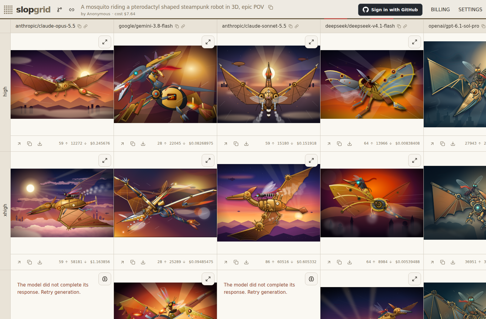

# slopgrid

Slopgrid lets you compare AI-generated outputs side by side. Build a grid of models, thinking efforts, or prompt variations, then watch them produce Markdown, images, SVG, or static websites using your OpenRouter account.

## Useful features

- Allows you to limit inference spending in USD per text inference call.
- Tries to prevent hitting inference budget limits by pre-checking your OpenRouter allowance and suggesting parallelism with a safety margin, while sharing available workers fairly.
- Makes sharing and collaboration easy through forking. Your data is private by default, and public grids cannot be deleted because we don't want important benchmark data to disappear.

## Supported grid layouts

You define what the columns and rows of a grid mean, choosing from the following dimensions for each axis.

### Image outputs

- Models
- Prompt variables
- Image sizes, including custom pixel dimensions
- Aspect ratios
- Quality levels
- Backgrounds: automatic, transparent, or opaque
- Groups of input reference images

### SVG, Markdown, and Website outputs

- Models
- Thinking efforts
- Prompt variables
